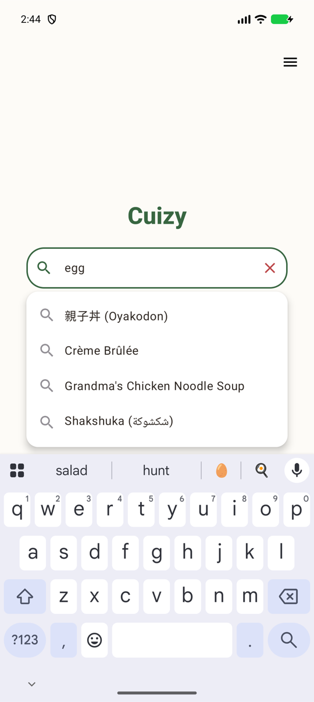
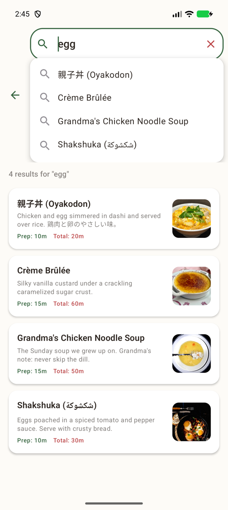
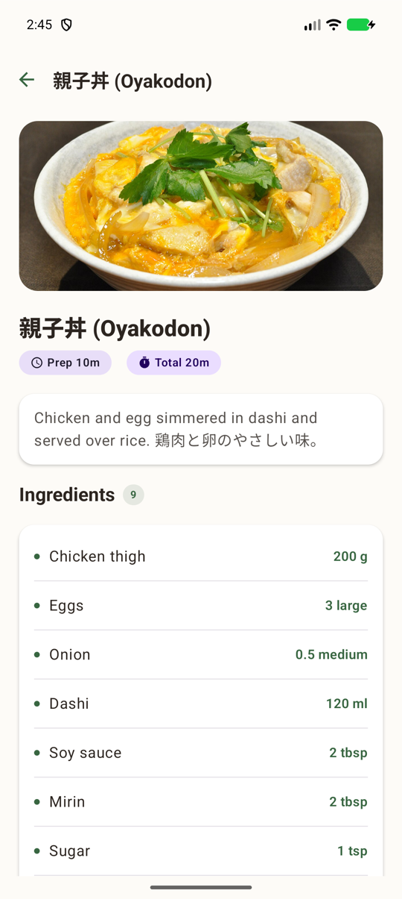
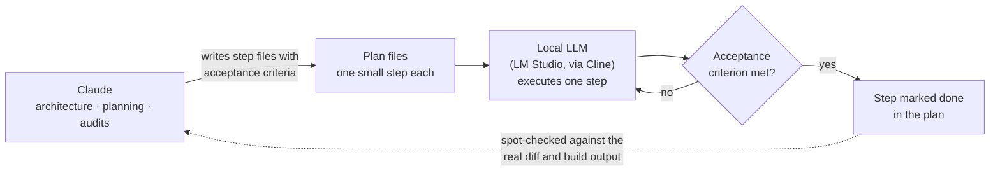

# Hi, I'm Ivan 👋

I plan products and direct AI models to build them. I'm looking for technical product and program
management roles where AI is part of the job: planning and organizing development pipelines
around AI models, and using AI to turn ideas into working prototypes.

## Why I built this

Using AI well is more than chatting with it. I wanted to show, with a real product rather than a
claim, that I can take an idea from product vision to a working app by planning the work,
choosing which model does what, and verifying what comes back.

**Cuizy**, a recipe manager for Android, is that product. The app is the output; the planning and
the AI development pipeline behind it are what this page is about.

## The product: Cuizy

A private, offline home for a family's recipe collection: no account, no subscription, and no
forced cloud dependency.

  
  
  
  

- **Recipes with photos.** Ingredients, steps, and up to 5 photos per recipe.
- **Multilingual search.** Finds recipes by title or ingredient in any script, tested against
  Japanese, Arabic, and accented Latin text.
- **Backup and restore you own.** The whole collection exports to a single file you can keep
  anywhere, including your own Google Drive.

A native Android app (Kotlin, Jetpack Compose), built almost entirely by AI models working from
step-by-step plans.

## How I plan the product

- **Vision first.** A written product vision and eight core pillars, such as lifetime ownership
  and full offline access, decide what gets built and what doesn't.
- **A phased roadmap, each phase with a user-facing goal.** Phase 1 was the smallest version
  someone could actually use. Backup and Restore and Recipe Photos followed, and Edit a Recipe
  is in progress.
- **A tracked work breakdown.** Every phase, feature group, and step is a GitHub issue on a
  project board, 48 so far. Ideas that aren't scheduled yet, such as scaling servings or
  importing a recipe from a URL, wait in a features backlog.
- **Scope decisions made on purpose and written down.** The backup file format reserved space
  for photos a full phase before photos existed, so adding them needed no format change.
  Editing photos on a saved recipe was deliberately deferred to the Edit a Recipe phase.

## How I run development with AI

- **Plans before code.** I plan each feature with Claude as a set of small step files. Each step
  names exact file paths and has one falsifiable acceptance criterion, such as a command that
  must exit 0. Recipe Photos shipped as 20 steps; Edit a Recipe is planned as 18.
- **Steps sized for the model.** Local models run with small context windows, so every step is
  self-contained and driven by one reusable prompt template with only the file name swapped.
- **Verify, don't trust.** "The model reported success" and "the build succeeded" are treated as
  separate claims. The first audit pass caught three real bugs before the project had ever
  compiled, and one agent created a file despite an explicit "do not execute" instruction, which
  is why every step now carries its own pass/fail check.
- **Right model for the job.** Claude handles anything that needs judgment. Local models
  (Qwen2.5-Coder 14B and Gemma 4, on a single 24GB Mac) execute narrowly scoped steps, and I've
  documented where they hold up and where they don't.
- **A deliberate human-in-the-loop boundary.** How much the models verify for themselves was
  widened step by step as trust was earned, as an explicit decision rather than by default.

The Cuizy repository is private while the app is in active development. I'm happy to walk through
the product plans and the development pipeline behind it.
