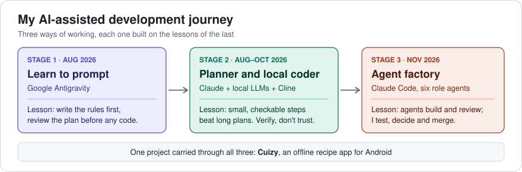
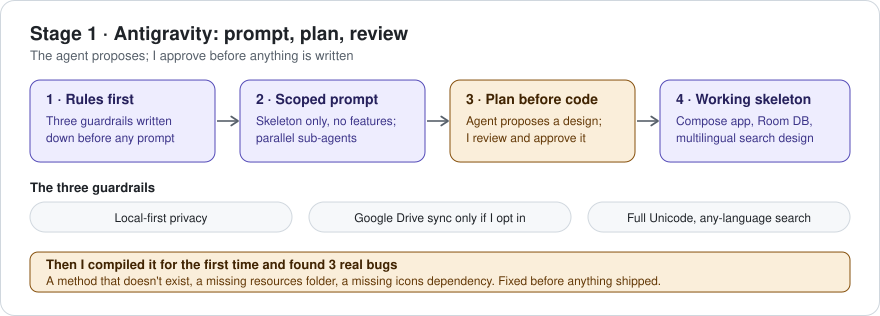
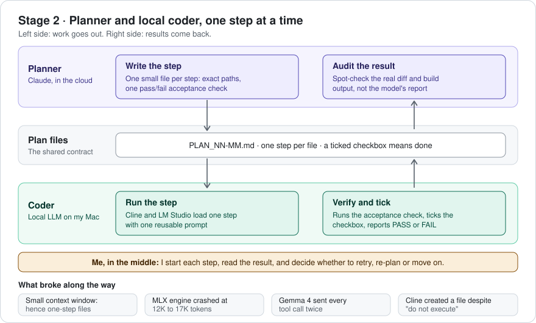
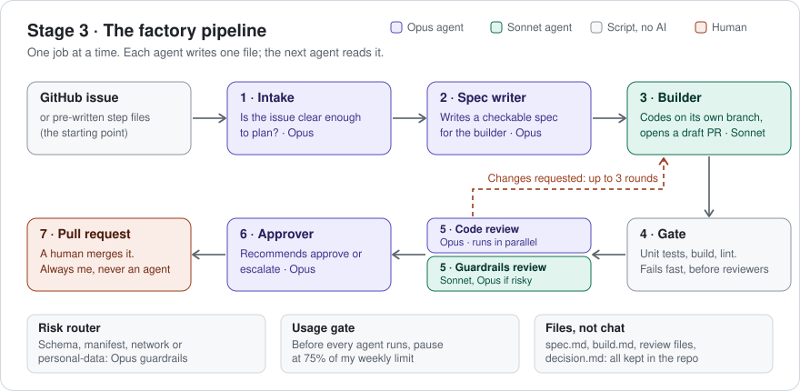
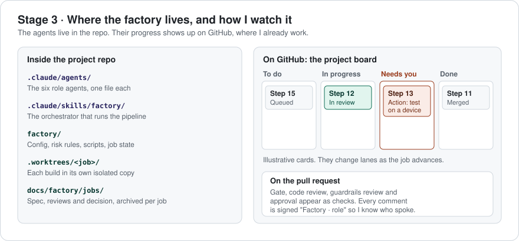
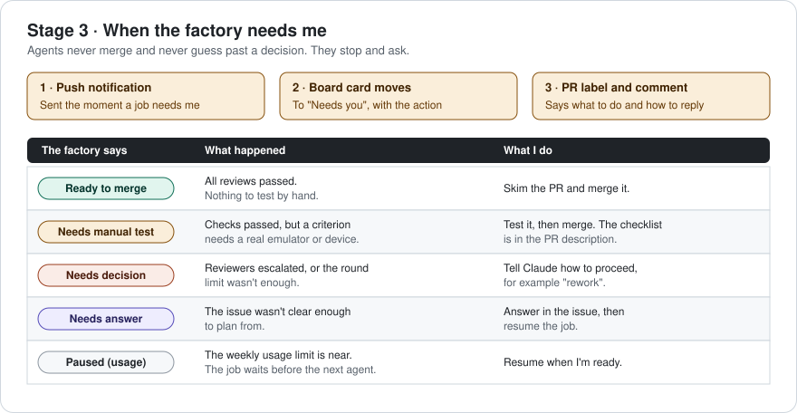
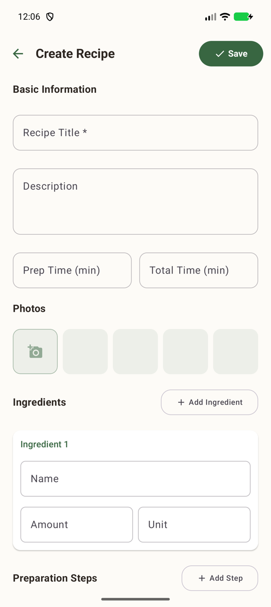

# Hi, I'm Ivan 👋

I plan products and direct AI to build them. This page is the record of how I learned to do that
well: from my first prompts to a pipeline of six AI agents where **I approve every merge**.

I'm looking for roles where using AI well is paramount: raising productivity, sharpening
communication, and getting from an idea to a working prototype quickly without giving up quality.

**[Journey](#the-journey)** · **[Stage 1](#stage-1-learn-to-prompt)** · **[Stage 2](#stage-2-planner-and-local-coder)** · **[Stage 3](#stage-3-agent-factory)** · **[Projects](#projects)** · **[Contact](#what-im-looking-for)**

**So far, on one app:** 4 product phases shipped · 70+ tracked work items · 3 ways of working tried ·
every merge approved by a human (me)

| Project | What it is | Status |
|---|---|---|
| **[Cuizy](#cuizy)** | A private, offline recipe manager for Android, the app everything below was tested on | Private repo while in active development |
| **[Agentic software factory](#agentic-software-factory)** | Six Claude Code agents that take a GitHub issue to a reviewed pull request | Private repo for now |

<!-- When a repo goes public, change its link above to the repo URL
     (https://github.com/hwyung/Cuizy or https://github.com/hwyung/agentic_software_factory)
     and pin it on the profile page. -->

---

## The journey

Each stage came from something the previous one got wrong. All three were applied to the same
project, a real Android app called [Cuizy](#cuizy), so the lessons are tested on something
that has to work.

---

## Stage 1: Learn to prompt

- **Rules before code.** I wrote three guardrails first (everything stays on the device, cloud
  sync only if the user opts in, search works in any language) and pointed every prompt at them.
- **Scoped prompt, plan review.** I asked for the skeleton only, no features, and required the
  agent to show me its plan before touching any files. It proposed a multilingual search design
  that I reviewed and approved.
- **What I found.** The first time the generated code was compiled, it had three real bugs.
  "The agent said it's done" and "it builds" turned out to be different claims.
- **Takeaway:** writing the rules down first, and reviewing the plan before the code, is where
  most of the leverage is.

---

## Stage 2: Planner and local coder

- **Split the work by judgment.** Claude plans and audits. Local models (Qwen2.5-Coder 14B and
  Gemma 4, on a single 24GB Mac, run through LM Studio and Cline) execute narrowly scoped steps.
- **Steps sized for the model.** Local models ran with small context windows, so every step is
  one file with exact paths and one pass/fail check, driven by one reusable prompt.
- **Measured, not assumed.** I logged where local models hold up and where they don't: engine
  crashes, duplicated tool calls, and an agent that created a file after being told not to.
- **Takeaway:** small, checkable steps beat long plans. I also learned when to stop: by Phase 4
  of the app, supervising local models cost more than it saved, so I moved to Stage 3.

---

## Stage 3: Agent factory

I built a software factory in Claude Code. Six agents each do one job, hand work to the next
one through files, and stop to ask me whenever a human decision is needed.

- **Right model for the job.** Opus for judgment (intake, spec, code review, approval), Sonnet
  for building. A risk router upgrades the guardrails review to Opus when a change touches the
  database schema, permissions, networking, or personal data.
- **Cheap checks first.** A script runs tests, build and lint before any reviewer spends
  tokens. Two reviewers (code, guardrails) then run in parallel, and an approver recommends
  merge or escalate.
- **Nothing merges without me.** Agents open pull requests and never merge them.

### Where it lives and how I watch it

### When it needs me

- **Takeaway:** the skill isn't getting agents to write code. It's deciding what each agent
  owns, what it has to prove, and where a person has to stay in the loop.

---

## Projects

### Cuizy

A private, offline recipe manager for Android: no account, no subscription, no forced cloud.
Native Kotlin and Jetpack Compose. The app is the output; the process above is the point.

  
  
  
  

- **Recipes with photos.** Ingredients, steps, and up to 5 photos per recipe.
- **Multilingual search.** Finds recipes by title or ingredient in any script, tested against
  Japanese, Arabic, and accented Latin text.
- **Backup and restore you own.** The whole collection exports to one file you can keep
  anywhere, including your own Google Drive.

#### Receipts

Phase 4 (editing and deleting recipes) was built through the factory. In its three pull requests:

- **7 build rounds, and reviewers sent work back 5 times.** Two of the three jobs needed rework
  before approval. That is the system working: the point of review is to find things.
- **A layout bug that came from the plan itself.** Reordering photos would have collapsed the
  photo row into one giant square. The code reviewer traced it to a library detail, and the fix
  went into both the code and the plan.
- **Data loss on a back button.** Editing a recipe deleted its saved photos immediately. Backing
  out of the edit would have left the recipe pointing at missing files, and then every future
  backup export would fail. Both reviewers flagged it independently.
- **A promise the code didn't keep.** Deleting a recipe told the user its photos were deleted,
  but the files stayed on the device.
- **A test that didn't test what it claimed.** In round 3 the reviewer noticed one test never
  exercised the guard it was named after. I approved one more round to fix just that test.
- **A human stop that mattered.** One job was held back purely because drag-to-reorder can only
  be proven on a real emulator. The factory escalated and waited for me.

The Cuizy repository is private while the app is in active development. I'm happy to walk through
the plans, the review files and the board.

<b>How I plan the product</b>

- **Vision first.** A written product vision and eight core pillars, such as lifetime ownership
  and full offline access, decide what gets built and what doesn't.
- **A phased roadmap, each phase with a user-facing goal.** Phase 1 was the smallest version
  someone could use. Backup and restore, recipe photos, and editing a recipe followed.
- **A tracked work breakdown.** Every phase, feature group and step is a GitHub issue on a
  project board. Ideas that aren't scheduled yet wait in a backlog.
- **Scope decisions made on purpose and written down.** The backup format reserved space for
  photos a full phase before photos existed, so adding them needed no format change.

### Agentic software factory

The pipeline from [Stage 3](#stage-3-agent-factory): intake, spec writer, builder, two reviewers
and an approver, with a human merging every pull request. It is the tool that built Phase 4 of
[Cuizy](#cuizy). The repository is private for now; I'll link it here when it goes public.

---

## What I'm looking for

AI-first technical product or program management: planning and organizing AI development
pipelines, and prototyping with AI. If that sounds like your team, I'd like to talk.

<!-- TODO: add the preferred contact (LinkedIn, email or a contact page) before publishing. -->
